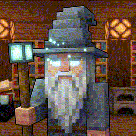

<div align="center">

  

# 🧙‍♂️ Gandalf the BOT

**The Istari of Discord &mdash; High-Performance Minecraft Telemetry, Cinema Engine & Autonomous AI Companion**

  <p>
    <a href="https://github.com/Marvelousshivam/Gandalf-The-bot/stargazers">
      
    </a>
    <a href="https://github.com/Marvelousshivam/Gandalf-The-bot/network/members">
      
    </a>
    <a href="https://github.com/Marvelousshivam/Gandalf-The-bot/issues">
      
    </a>
    <a href="https://github.com/Marvelousshivam/Gandalf-The-bot/blob/main/LICENSE">
      
    </a>
    <a href="#">
      
    </a>
    <a href="#">
      
    </a>
    <a href="#">
      
    </a>
    <a href="#">
      
    </a>
  </p>

  <h3>
    <a href="#-about">About</a>
    <span> &bull; </span>
    <a href="#-core-features">Features</a>
    <span> &bull; </span>
    <a href="#-movie-nights-suite">Movie Nights</a>
    <span> &bull; </span>
    <a href="#-minecraft-suite">Minecraft Suite</a>
    <span> &bull; </span>
    <a href="#-ai-lore-engine">AI & Lore</a>
    <span> &bull; </span>
    <a href="#-tech-stack">Tech Stack</a>
    <span> &bull; </span>
    <a href="#-slash-commands">Commands</a>
    <span> &bull; </span>
    <a href="#-project-structure">Structure</a>
    <span> &bull; </span>
    <a href="#-getting-started">Installation</a>
    <span> &bull; </span>
    <a href="#-roadmap">Roadmap</a>
  </h3>

</div>

---

## <a id="-about"></a> About Gandalf the BOT

> *"A wizard is never late, nor is he early. He arrives precisely when he means to."*

> [!NOTE]
> **Gandalf the BOT** is a modern, omnipotent Discord companion crafted for gaming servers, Minecraft realms, and media communities. Built with **Discord.js v14**, **Node.js native SQLite (`node:sqlite`)** in high-throughput WAL mode, a Rust-accelerated **`@napi-rs/canvas`** image synthesizer, and dual AI inference (**Groq LLaMA 3.3** + **OpenRouter** fallback), Gandalf manages everything from live server telemetry to cinematic community movie nights.

---

## <a id="-core-features"></a> Core Features

---

### <a id="-movie-nights-suite"></a> Movie Nights & Cinema Suite
> End-to-end community film management powered by **The Movie Database (TMDB)**.

*  **Live TMDB Search & Autocomplete (`/movie search`):** Real-time movie lookups with dynamic selection modals, high-resolution original posters, backdrop banners, release years, vote averages, age certifications, directors, runtimes, and direct YouTube trailer action buttons.
*  **Hybrid Event Scheduling (`/movie plan`):** Simultaneously schedules an official native **Discord Guild Scheduled Event** (complete with TMDB cover art and description) and deploys an interactive in-channel RSVP card with live attendee synchronization.
*  **Interactive Voting Polls (`/movie poll`):** Multi-movie head-to-head showdowns (2&ndash;5 films). Server members cast single votes via buttons, live updating real-time ASCII percentage progress bars (`▰▰▰▰▱▱ 60%`). Auto-closes after a configurable duration with 1-click winner scheduling.
*  **Palantír's Choice Roulette (`/movie roulette`):** Defeats decision fatigue. Gandalf gazes into the seeing-stone to pick a random film from your backlog, curated fantasy/sci-fi pools, or top-rated classics with dramatic reveal animations.
*  **Server Watchlist Queue (`/movie watchlist`, `/movie suggest`):** Collaborative server queue stored in SQLite. Features pagination, instant launch buttons, and a historical archive for previously watched movies.
*  **Automated Showtime Alerts:** Background cron monitors scheduled showtimes and pings `@MovieNight` or confirmed attendees at **1 hour** and **10 minutes** before the curtain rises.
*  **Gandalf AI Movie Reviews (`/movie review`):** Gandalf delivers an in-character cinematic review written in Tolkien prose, drawing comparisons to Middle-earth lore and awarding a custom Wizard Rating (*✨ 9.5/10 Staves of Light*).

---

### <a id="-minecraft-suite"></a> Minecraft Guild & Canvas Rendering
> Native server list ping protocol and high-speed image synthesis.

*  **Real-Time Server List Ping (`/status`):** Direct TCP SLP handshake with fallback mirrors (`mcstatus.io`, `mcsrvstat.us`). Reports online players, max capacity, latency, version, and raw formatted MOTD.
*  **Canvas Crafting GUI (`/recipe`):** Generates authentic pixel-perfect 3x3 Minecraft crafting tables using `@napi-rs/canvas` and official `minecraft-data` item sprites for over 1,000+ crafting and smelting recipes.
*  **2D Skin & Cape Engine (`/skin`):** Custom 2D avatar and body renderer supporting Mojang accounts (via MC-Heads API) as well as offline/cracked skins (TLauncher auth skin services).
*  **Advancement Toast Popups (`/advancement`):** Generates customizable Minecraft advancement toast graphics in vanilla font with custom titles, descriptions, and icon sprites.
*  **Title Screen Welcome Cards:** Generates nostalgic Minecraft main menu banners with dirt background tiles, official title logos, player avatars, and randomized yellow splash text.
*  **In-Game Encyclopedia (`/enchant`, `/potion`, `/mob`, `/coords`):** Comprehensive game reference for item enchantments, brew recipes, mob statistics, and server coordinates database.

---

### <a id="-ai-lore-engine"></a> Istari AI Brain & Middle-earth Lore
> Conversational wizard intelligence with multi-provider redundancy.

*  **Dual AI Fallback:** Primary inference runs on **Groq** (`llama-3.3-70b-versatile` / `openai/gpt-oss-120b`) for sub-second responses, with automatic failover to **OpenRouter** (`meta-llama/llama-3.3-70b-instruct`).
*  **Fellowship Relationship Engine:** Gandalf remembers the bot creator as his dearest hobbit companion and addresses community members by their Minecraft rank progression.
*  **Offline Wisdom Safety Net:** If all AI services are temporarily unreachable, Gandalf smoothly reverts to deterministic Tolkien quotes and aphorisms without crashing.

---

### <a id="-moderation-suite"></a> Security, Moderation & Support Tickets
> Robust community protection and staff workflows.

*  **Moderation Suite:** Complete staff controls (`/warn`, `/warnings`, `/clearwarn`, `/mute`, `/unmute`, `/kick`, `/ban`, `/purge`). Includes automated warn escalation (3 warns &rarr; 1-hour timeout, 5 warns &rarr; permanent ban).
*  **AutoMod Shield:** Regex-powered profanity filtering (`bad-words.json`), unauthorized Discord invite link suppression, duplicate message rate limiting, and spam detection.
*  **Interactive Ticket Desks (`/ticket`, `/close-ticket`):** Modal-driven private support ticket channels with category selection, permission isolation, and transcript generation.
*  **Audit Logging:** Logs message edits, deletions, member joins/leaves, and mod actions to dedicated channels.

---

### <a id="-leveling-suite"></a> Gamification, XP & Ranks
> Engaging community progression with custom visual rank cards.

*  **Custom Canvas Rank Cards (`/rank`):** Generates high-res image cards featuring member avatar, circular clipping mask, XP progress bar, rank badges, and level metrics.
*  **Server Leaderboard (`/leaderboard`):** Displays top adventurers across the guild with tier titles from *Stone Miner* to *Gandalf's Apprentice*.

---

## <a id="-tech-stack"></a> Tech Stack

| Layer | Technology | Purpose |
| :--- | :--- | :--- |
| **Runtime** | [Node.js](https://nodejs.org/) v24+ | Modern JavaScript runtime supporting native SQLite and ES modules |
| **Framework** | [Discord.js](https://discord.js.org/) v14.18 | WebSocket connection, interactions, Guild Scheduled Events, embeds |
| **Database** | [`node:sqlite`](https://nodejs.org/api/sqlite.html) | Built-in zero-dependency SQLite with Write-Ahead Logging (WAL) |
| **Graphics** | [`@napi-rs/canvas`](https://github.com/Brooooooklyn/canvas) | Rust-backed Canvas API for high-speed server status & rank cards |
| **Cinema Data** | [The Movie Database (TMDB)](https://www.themoviedb.org/) | Movie search, metadata, poster art, backdrops, and YouTube trailers |
| **AI Inference** | [Groq Cloud](https://groq.com/) | Ultra-low latency LLaMA 3.3 70B & GPT-OSS inference |
| **AI Fallback** | [OpenRouter](https://openrouter.ai/) | High-reliability secondary AI gateway for fallback redundancy |
| **Game Data** | [minecraft-data](https://github.com/PrismarineJS/node-minecraft-data) | Recipe trees, item sprites, entity stats, and enchantment IDs |
| **Process Manager** | [PM2](https://pm2.keymetrics.io/) | Production process management, log rotation, and zero-downtime reboots |

---

## <a id="-slash-commands"></a> Slash Commands Reference

<details open>
<summary><b>🍿 Movie Nights Commands (<code>/movie</code>)</b></summary>

| Command | Arguments | Description |
| :--- | :--- | :--- |
| `/movie search` | `query` *(required)* | Search TMDB and view details, ratings, cast, and trailers |
| `/movie plan` | `title` *(required)*, `time` *(required)*, `channel` *(optional)* | Schedule a movie event with Discord Event + RSVP card |
| `/movie poll` | `duration` *(optional)*, `movie1..movie5` | Host a multi-movie voting poll with live progress bars |
| `/movie suggest` | `title` *(required)* | Propose a film to be added to the server watchlist |
| `/movie watchlist`| `action` *(list / remove / watched / clear)* | Browse and manage the persistent server movie watchlist |
| `/movie roulette` | `genre` *(optional)*, `source` *(optional)* | Let the Palantír pick a random movie when undecided |
| `/movie review` | `title` *(required)* | Summon Gandalf to deliver an in-character AI movie critique |

</details>

<details>
<summary><b>⛏️ Minecraft & Canvas Commands</b></summary>

| Command | Arguments | Description |
| :--- | :--- | :--- |
| `/status` | *none* | Check live Minecraft server latency, player count, and MOTD |
| `/recipe` | `item` *(required)* | Generate a 3x3 crafting grid image for any item |
| `/skin` | `username` *(required)*, `type` *(mojang / tlauncher)* | Render and inspect player skins and capes in 2D |
| `/advancement` | `title`, `description`, `icon` | Render a custom Minecraft advancement toast popup |
| `/enchant` | `name` *(required)* | View enchantment max level, primary items, and mechanics |
| `/potion` | `name` *(required)* | View brewing recipes, ingredient steps, and effect durations |
| `/mob` | `name` *(required)* | View mob health, behavior, spawn conditions, and drops |
| `/coords` | `action` *(add / list / get / remove)* | Manage shared waypoint coordinates across dimensions |

</details>

<details>
<summary><b>🧙‍♂️ AI & Lore Commands</b></summary>

| Command | Arguments | Description |
| :--- | :--- | :--- |
| `/ask-gandalf` | `question` *(required)* | Ask Gandalf any question with Groq/OpenRouter AI |
| `/gandalf` | *none* | Receive iconic wisdom quotes from Gandalf the Grey/White |
| `/gandalf-gif` | *none* | Send a curated animated GIF of Gandalf |
| `/story` | *none* | Read an epic tale of Middle-earth adventure |
| `/backstory` | *none* | Learn the origin lore of Gandalf the BOT and the server |

</details>

<details>
<summary><b>🛡️ Moderation & Tickets Commands</b></summary>

| Command | Arguments | Description |
| :--- | :--- | :--- |
| `/warn` | `user`, `reason` | Issue an official warning (auto-escalates to mute/ban) |
| `/warnings` | `user` | Inspect a user's infraction history |
| `/clearwarn` | `user` | Clear recorded warnings for a user |
| `/mute` | `user`, `duration`, `reason` | Temporarily timeout a user |
| `/unmute` | `user`, `reason` | Lift a user's timeout early |
| `/kick` | `user`, `reason` | Kick a user from the guild |
| `/ban` | `user`, `reason`, `delete_days` | Permanently ban an offender |
| `/purge` | `amount` | Bulk delete messages in the active channel |
| `/ticket` | `subject` | Open a private support channel with server staff |
| `/close-ticket` | `reason` | Close and archive an active support ticket |

</details>

<details>
<summary><b>📊 Leveling & Utility Commands</b></summary>

| Command | Arguments | Description |
| :--- | :--- | :--- |
| `/rank` | `user` *(optional)* | Display your generated Canvas rank card and XP progress |
| `/leaderboard` | *none* | View the server-wide top 10 XP rankings |
| `/ping` | *none* | Check bot heartbeat, REST API latency, and uptime |
| `/serverinfo` | *none* | Display guild creation date, members, boosts, and security |
| `/userinfo` | `user` *(optional)* | Display detailed account registration and roles for a user |
| `/help` | `category` *(optional)* | Interactive guide covering all bot features and syntax |

</details>

---

## <a id="-project-structure"></a> Project Structure

```
Gandalf-The-bot/
├── assets/
│   └── gandalf.gif                 # Animated hero banner & bot mascot
├── src/
│   ├── assets/
│   │   └── fonts/Minecraft.otf     # Authentic pixel font for canvas generation
│   ├── commands/                   # Application Slash Commands (35+)
│   │   ├── admin/                  # Configuration & guild setup
│   │   ├── fun/                    # AI chat, movie nights, lore, and quotes
│   │   ├── leveling/               # Rank card and guild leaderboards
│   │   ├── minecraft/              # Status, recipes, skins, and game data
│   │   ├── moderation/             # Warns, mutes, kicks, bans, and purge
│   │   ├── tickets/                # Support desk & closure handlers
│   │   └── utility/                # Ping, help, userinfo, and serverinfo
│   ├── data/                       # Static datasets (recipes, quotes, bad words)
│   ├── events/                     # Discord.js Event Listeners
│   │   ├── ready.js                # Bot boot, status initialization, cron start
│   │   ├── interactionCreate.js    # Slash commands, button RSVPs & modals
│   │   ├── messageCreate.js        # XP gain, chat bridge & AutoMod shield
│   │   ├── messageDelete.js        # Audit logging
│   │   └── guildMemberAdd.js       # Welcome cards with custom canvas graphics
│   ├── systems/                    # Core Subsystems
│   │   ├── advancementImage.js     # Minecraft advancement toast generator
│   │   ├── auditLogger.js          # Channel audit dispatcher
│   │   ├── autoMod.js              # Spam, invite & bad-word detection
│   │   ├── craftingImage.js        # 3x3 Canvas crafting grid synthesizer
│   │   ├── movieNightDisplay.js    # TMDB embed & RSVP UI generator
│   │   ├── movieNightScheduler.js  # Showtime reminder cron engine
│   │   ├── rankCard.js             # High-res Canvas rank card generator
│   │   ├── serverStatusDisplay.js  # Live SLP status widget manager
│   │   ├── skinRenderer.js         # 2D Minecraft skin & cape engine
│   │   └── xpSystem.js             # Chat XP calculation and level curves
│   ├── utils/                      # External APIs & Utilities
│   │   ├── ai.js                   # Dual Groq / OpenRouter inference client
│   │   ├── cooldown.js             # Slash command cooldown manager
│   │   ├── embedBuilder.js         # Standardized visual embed templates
│   │   ├── minecraft-api.js        # Direct TCP Server List Ping protocol
│   │   ├── movieReview.js          # AI wizard movie review prompt generator
│   │   ├── recipeDatabase.js       # minecraft-data item lookup index
│   │   └── tmdb.js                 # TMDB v3 API client (search, trailers, details)
│   └── database.js                 # node:sqlite WAL schema & query methods
├── deploy-commands.js              # Global/guild command deployment script
├── index.js                        # Main application bootstrap
├── package.json                    # Project metadata & dependencies
└── .env.example                    # Sample environment configuration
```

---

## <a id="-getting-started"></a> Getting Started

### 1. Prerequisites
* **Node.js**: `v20.0.0` or higher (`v24.x` recommended for built-in `node:sqlite`)
* **Discord Bot Token**: Create an application on the [Discord Developer Portal](https://discord.com/developers/applications) with `Guilds`, `GuildMessages`, `MessageContent`, `GuildMembers`, and `GuildScheduledEvents` intents enabled.
* **TMDB API Key**: Free API key from [The Movie Database (TMDB)](https://www.themoviedb.org/documentation/api) for Movie Nights features.
* **(Optional) AI Keys**: Free or paid keys from [Groq Cloud](https://console.groq.com/) or [OpenRouter](https://openrouter.ai/) for `/ask-gandalf` and `/movie review`.

---

### 2. Installation
```bash
# Clone the repository
git clone https://github.com/Marvelousshivam/Gandalf-The-bot.git
cd Gandalf-The-bot

# Install dependencies
npm install
```

---

### 3. Environment Configuration
Create a `.env` file by copying the provided template:
```bash
cp .env.example .env
```

Configure your environment variables in `.env`:
```env
# ==========================================
# Discord Application Credentials
# ==========================================
DISCORD_TOKEN=your_bot_token_here
CLIENT_ID=your_application_client_id_here
GUILD_ID=your_primary_discord_guild_id_here

# ==========================================
# Minecraft Realm / Server Telemetry
# ==========================================
MC_SERVER_ADDRESS=your.minecraftserver.net
MC_SERVER_PORT=25565

# ==========================================
# Cinema & Movie Nights (TMDB)
# ==========================================
TMDB_API_KEY=your_tmdb_api_key_v3_here

# ==========================================
# Istari AI Configuration (Dual Brain)
# ==========================================
GROQ_API_KEY=gsk_your_groq_api_key_here
OPENROUTER_API_KEY=sk-or-v1-your_openrouter_api_key_here
GROQ_MODEL=llama-3.3-70b-versatile
OPENROUTER_MODEL=meta-llama/llama-3.3-70b-instruct

# ==========================================
# Bot Owner & Administration
# ==========================================
BOT_OWNER_ID=your_discord_user_snowflake_id
```

---

### 4. Deploy Slash Commands
Register all application commands to Discord's API:
```bash
npm run deploy
```

---

### 5. Running Gandalf

#### Standard Node.js
```bash
# Production mode
npm start

# Development mode (Node 20+ built-in watch)
npm run dev
```

#### Production with PM2
```bash
# Start bot under PM2 supervision
pm2 start index.js --name "gandalf-bot"

# Enable automatic system reboot startup
pm2 save
pm2 startup
```

---

## <a id="-roadmap"></a> Roadmap

- [x] Full **TMDB Movie Nights** suite (Search, Hybrid Event Planning, RSVPs, Watchlists, Palantír Roulette)
- [x] **Gandalf AI Movie Reviews** with Tolkien persona and Middle-earth wisdom ratings
- [x] High-performance **`@napi-rs/canvas`** 3x3 Crafting Grid synthesizer
- [x] 2D Skin Engine supporting Mojang accounts and TLauncher auth
- [x] Direct TCP Minecraft **Server List Ping (SLP)** protocol implementation
- [x] Dual AI redundancy engine (**Groq** primary + **OpenRouter** fallback)
- [x] Persistent **`node:sqlite`** database with Write-Ahead Logging (WAL)
- [ ] Auto-syncing DiscordSRV bidirectional chat bridge module
- [ ] Next.js web dashboard with Discord OAuth2 for watchlist & config management
- [ ] Multi-language localization (i18n) for international realms

---

## <a id="-contributing"></a> Contributing

Contributions are welcome! Whether it's reporting a bug, adding new Minecraft recipes, or submitting feature requests:

1. **Fork** the repository
2. **Create** your feature branch (`git checkout -b feature/MithrilFeature`)
3. **Commit** your changes (`git commit -m 'feat: add mithril armor recipe'`)
4. **Push** to the branch (`git push origin feature/MithrilFeature`)
5. **Open** a Pull Request

---

## <a id="-license"></a> License

Distributed under the **MIT License**. See [`LICENSE`](LICENSE) for complete details.

---

<div align="center">
  <sub>Forged with ❤️ by the Fellowship for Minecraft & Cinema enthusiasts worldwide.</sub>
</div>